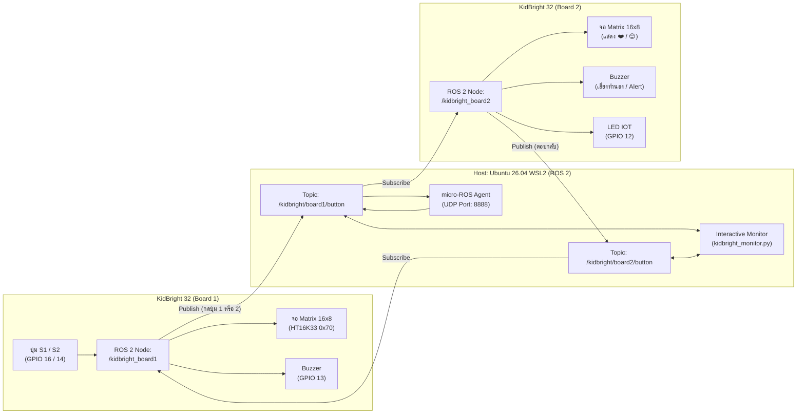

# การใช้งาน micro-ROS กับบอร์ด KidBright32 (ESP-WROOM-32) ให้สื่อสารข้ามบอร์ด

โปรเจกต์นี้สาธิตและจัดเตรียมโค้ดสำหรับการเชื่อมต่อ **บอร์ด KidBright 32 จำนวน 2 บอร์ด** เข้าสู่ระบบ **ROS 2** โดยใช้ **micro-ROS** ผ่าน Wi-Fi (UDP) หรือ Serial (USB) โดยมี Host เป็น **ROS 2 Kilted / Lyrical บน Ubuntu 26.04 WSL2**

---

## 1. ผังการทำงาน (Architecture Diagram)



---

## 2. ตาราง Pinout ฮาร์ดแวร์ KidBright 32 (ESP-WROOM-32)

| อุปกรณ์บนบอร์ด KidBright | ขา ESP32 (GPIO) | รูปแบบการต่อ / ฟังก์ชัน |
| :--- | :--- | :--- |
| **Switch 1 (ปุ่ม S1)** | `GPIO 16` (หรือ `14` ในบางรุ่น) | Active LOW (กดแล้วเป็น `0`) มี Pull-up ในตัว |
| **Switch 2 (ปุ่ม S2)** | `GPIO 14` (หรือ `16` ในบางรุ่น) | Active LOW (กดแล้วเป็น `0`) มี Pull-up ในตัว |
| **Buzzer (ลำโพง)** | `GPIO 13` | ต่อผ่านวงจร Drive ทรานซิสเตอร์ (ใช้ PWM / Tone) |
| **LED Matrix 16x8** | `GPIO 21` (SDA), `GPIO 22` (SCL) | ชิป **HT16K33** I2C Address `0x70` |
| **LED WIFI** | `GPIO 2` | แสดงสถานะการเชื่อมต่อ micro-ROS Agent |
| **LED IOT** | `GPIO 12` | กระพริบเมื่อมีการส่ง/รับข้อความ ROS 2 |

---

## 3. โครงสร้างไฟล์ในโปรเจกต์

```text
/home/racl/kb_uros/
├── README.md                           # คู่มือการติดตั้งและการใช้งานฉบับสมบูรณ์
├── firmware/
│   ├── common/
│   │   └── ht16k33_matrix.h            # ไดรเวอร์จอ 16x8 Matrix สำหรับ KidBright พร้อมไอคอนสำเร็จรูป
│   ├── kidbright_board1/
│   │   ├── kidbright_board1.ino        # สเก็ตช์ Arduino สำหรับ Board 1 (Node: kidbright_board1)
│   │   └── ht16k33_matrix.h
│   └── kidbright_board2/
│       ├── kidbright_board2.ino        # สเก็ตช์ Arduino สำหรับ Board 2 (Node: kidbright_board2)
│       └── ht16k33_matrix.h
└── host_ros2/
    └── scripts/
        ├── run_agent.sh                # สคริปต์รัน micro-ROS Agent (UDP / Serial)
        ├── setup_agent_ws.sh           # สคริปต์คอมไพล์ micro_ros_agent บน Ubuntu 26.04
        └── kidbright_monitor.py        # CLI แสดงสถานะสดและควบคุมสั่งการจากคอมพิวเตอร์
```

---

## 4. ขั้นตอนการตั้งค่าฝั่ง Host (Ubuntu 26.04 WSL2)

### ข้อควรรู้เรื่อง Network ของ WSL2:
micro-ROS สื่อสารผ่านโปรโตคอล UDP (พอร์ต 8888):
1. **แนะนำ (ง่ายที่สุดใน Windows 11):** เปิดใช้งาน **Mirrored Mode**
   - สร้างหรือแก้ไขไฟล์ `C:\Users\<Username>\.wslconfig` ใน Windows:
     ```ini
     [wsl2]
     networkingMode=mirrored
     ```
   - รีสตาร์ท WSL ใน PowerShell: `wsl --shutdown`
   - ในโหมดนี้ WSL2 จะแชร์ IP วงเดียวกับ Wi-Fi ของเครื่องคอมพิวเตอร์โดยตรง บอร์ด KidBright จึงส่งข้อมูลหา IP คอมพิวเตอร์ได้ทันที
2. **หากใช้โหมด NAT ปกติ:**
   - รัน PowerShell (Run as Administrator) เพื่อ Forward UDP หรือตรวจสอบว่า ESP32 สามารถ Ping IP ของ Host ได้

### 4.1 ตรวจสอบ IP ของเครื่อง Host
รันคำสั่งใน WSL:
```bash
hostname -I
```
นำ IP นี้ (หรือ IP Wi-Fi ของ Windows เช่น `192.168.1.xxx`) ไปใส่ในโค้ด Arduino ของทั้งสองบอร์ด

### 4.2 ติดตั้ง / รัน micro-ROS Agent
หากต้องการสร้าง micro-ROS Agent ใน workspace:
```bash
cd /home/racl/kb_uros/host_ros2/scripts
bash setup_agent_ws.sh
```

เมื่อติดตั้งเสร็จแล้ว สามารถสั่งรัน Agent เพื่อรอรับการเชื่อมต่อจาก KidBright ได้ด้วย:
```bash
bash run_agent.sh udp 8888
```

หรือหากติดตั้ง `micro_ros_agent` ไว้แล้วใน ROS 2:
```bash
source /opt/ros/lyrical/setup.bash
ros2 run micro_ros_agent micro_ros_agent udp4 --port 8888 -v6
```

---

## 5. ขั้นตอนการตั้งค่าบอร์ด KidBright ใน Arduino IDE

### 5.1 ติดตั้ง Board ESP32
1. เปิด **Arduino IDE** เข้าไปที่ `File` > `Preferences`
2. ในช่อง *Additional Boards Manager URLs* ใส่:
   ```text
   https://espressif.github.io/arduino-esp32/package_esp32_index.json
   ```
3. ไปที่ `Tools` > `Board` > `Boards Manager...` ค้นหา **esp32** แล้วกด **Install**
4. เลือกบอร์ด: `Tools` > `Board` > `esp32` > **ESP32 Dev Module** (หรือ KidBright32)

### 5.2 ติดตั้ง Library micro_ros_arduino
1. ดาวน์โหลดไฟล์ Zip ของ Library `micro_ros_arduino` (เวอร์ชัน `kilted` หรือ `jazzy`):
   - GitHub Releases: [https://github.com/micro-ROS/micro_ros_arduino/releases](https://github.com/micro-ROS/micro_ros_arduino/releases)
2. ใน Arduino IDE เลือกเมนู: `Sketch` > `Include Library` > `Add .ZIP Library...` แล้วเลือกไฟล์ที่ดาวน์โหลดมา

### 5.3 อัปโหลดโค้ดลงบอร์ด KidBright

#### บอร์ดที่ 1 (Board 1):
1. เปิดไฟล์ [kidbright_board1.ino](file:///home/racl/kb_uros/firmware/kidbright_board1/kidbright_board1.ino)
2. แก้ไขข้อมูล Wi-Fi และ IP ของ Host:
   ```cpp
   char ssid[] = "ชื่อ_WIFI_ของท่าน";
   char password[] = "รหัสผ่าน_WIFI";
   char agent_ip[] = "192.168.1.100"; // ใส่ IP ของเครื่องคอมพิวเตอร์ที่รัน micro-ROS Agent เป็น string
   ```
3. เสียบสาย USB เข้า KidBright บอร์ด 1 แล้วกดปุ่ม **Upload**

#### บอร์ดที่ 2 (Board 2):
1. เปิดไฟล์ [kidbright_board2.ino](file:///home/racl/kb_uros/firmware/kidbright_board2/kidbright_board2.ino)
2. แก้ไขชื่อ Wi-Fi, รหัสผ่าน และ `agent_ip` เหมือนกับบอร์ดที่ 1
3. เสียบสาย USB เข้า KidBright บอร์ด 2 แล้วกดปุ่ม **Upload**

---

## 6. รูปแบบการสื่อสารและการทดสอบ

### สถานะเริ่มต้นเมื่อเปิดเครื่อง:
- **LED WIFI (GPIO 2)**: จะกระพริบขณะกำลังค้นหาและเชื่อมต่อกับ micro-ROS Agent
- เมื่อเชื่อมต่อสำเร็จ: **LED WIFI จะติดค้าง** และจอแสดงผลจะโชว์หมายเลขประจำบอร์ด:
  - บอร์ด 1 แสดงเลข **`1`**
  - บอร์ด 2 แสดงเลข **`2`**

### การทดสอบสื่อสารข้ามบอร์ด:
1. **กดปุ่ม S1 บนบอร์ดที่ 1:**
   - บอร์ด 1 ส่งสัญญาณผ่าน ROS Topic: `/kidbright/board1/button` (ค่า `1`)
   - **บอร์ดที่ 2 ตอบสนองทันที:**
     - จอ Matrix 16x8 แสดงรูปหัวใจ **❤️ (Heart)**
     - ลำโพง Buzzer (GPIO 13) เล่นเสียงทำนองเพลง Happy Chime (โน้ต C5 -> E5 -> G5 -> C6)
     - ไฟ LED IOT (GPIO 12) กระพริบ

2. **กดปุ่ม S2 บนบอร์ดที่ 1:**
   - บอร์ด 1 ส่งสัญญาณผ่าน ROS Topic: `/kidbright/board1/button` (ค่า `2`)
   - **บอร์ดที่ 2 ตอบสนองทันที:**
     - จอ Matrix 16x8 แสดงรูปยิ้ม **😊 (Smile)**
     - ลำโพง Buzzer เล่นเสียงเตือน Beep 2 จังหวะ
     - ไฟ LED IOT กระพริบ

3. **กดปุ่มบนบอร์ดที่ 2 กลับมา:**
   - บอร์ด 2 ส่งสัญญาณผ่าน Topic: `/kidbright/board2/button`
   - บอร์ด 1 ได้รับและแสดงผลเช่นเดียวกัน (เป็นการสื่อสารสองทางสมบูรณ์แบบ)

---

## 7. การตรวจสอบและทดสอบผ่านหน้าจอ Host (WSL)

ท่านสามารถเปิด Terminal ใหม่ใน Ubuntu WSL เพื่อมอนิเตอร์และสั่งการบอร์ดทั้งสองได้:

```bash
source /opt/ros/lyrical/setup.bash
python3 /home/racl/kb_uros/host_ros2/scripts/kidbright_monitor.py
```

### หน้าจอจะแสดง:
- เหตุการณ์กดปุ่มของทั้งสองบอร์ดแบบ Real-time พร้อมสีสันสวยงาม
- สามารถพิมพ์เลขบนคีย์บอร์ดคอมพิวเตอร์เพื่อส่งคำสั่งทดสอบไปยังบอร์ดได้ทันที:
  - กด `1` + Enter: สั่งให้บอร์ด 2 เล่นเสียงเพลงและแสดงรูป ❤️
  - กด `2` + Enter: สั่งให้บอร์ด 2 เล่นเสียงเตือนและแสดงรูป 😊
  - กด `3` + Enter: สั่งให้บอร์ด 1 เล่นเสียงเพลงและแสดงรูป ❤️
  - กด `4` + Enter: สั่งให้บอร์ด 1 เล่นเสียงเตือนและแสดงรูป 😊

นอกจากนี้ยังสามารถใช้คำสั่งมาตรฐานของ ROS 2 ได้ เช่น:
```bash
# ดูรายชื่อ Node
ros2 node list

# ดูรายชื่อ Topic
ros2 topic list

# ฟังข้อมูลจากบอร์ด 1
ros2 topic echo /kidbright/board1/button
```
